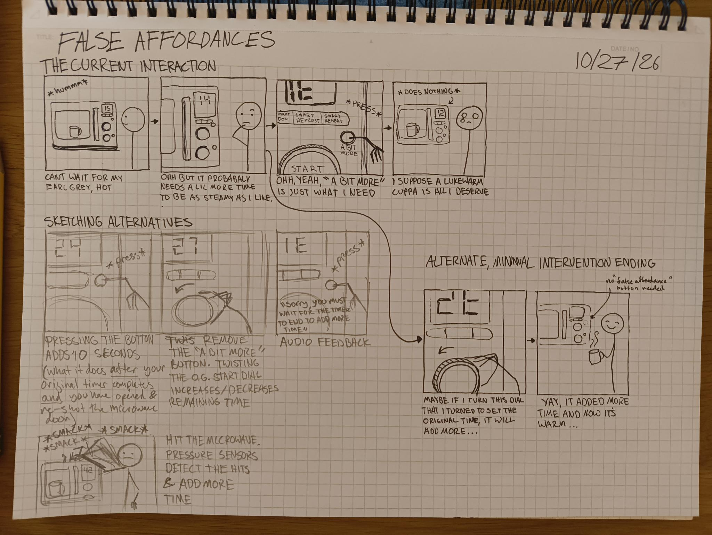
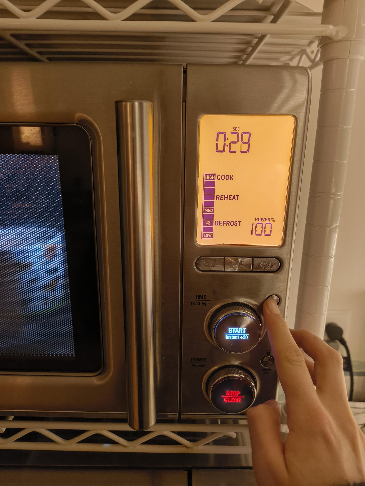
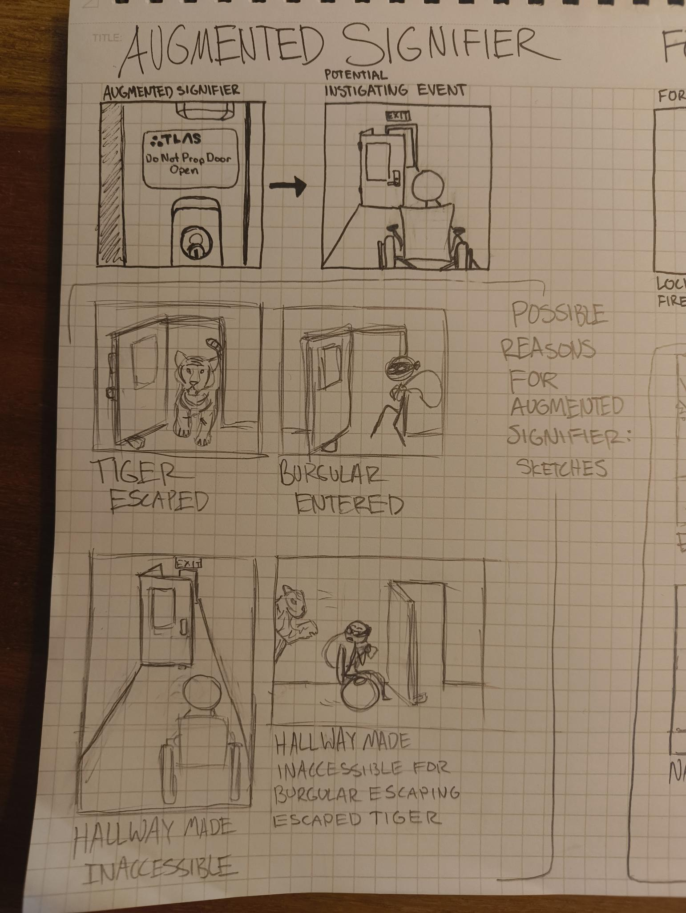
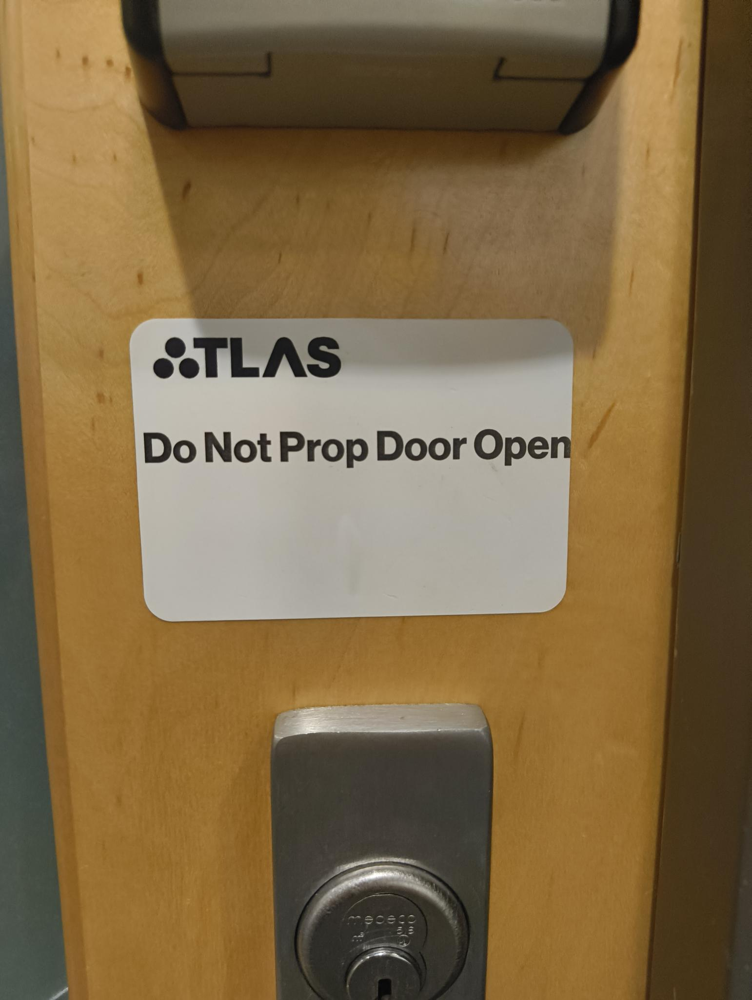
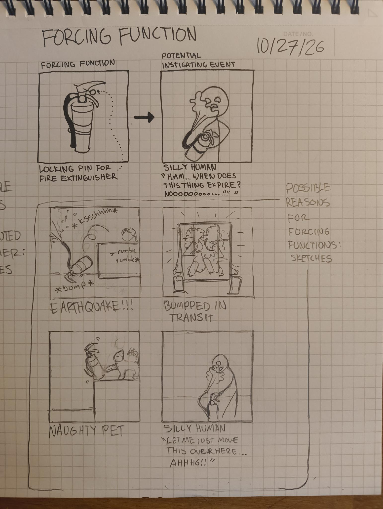
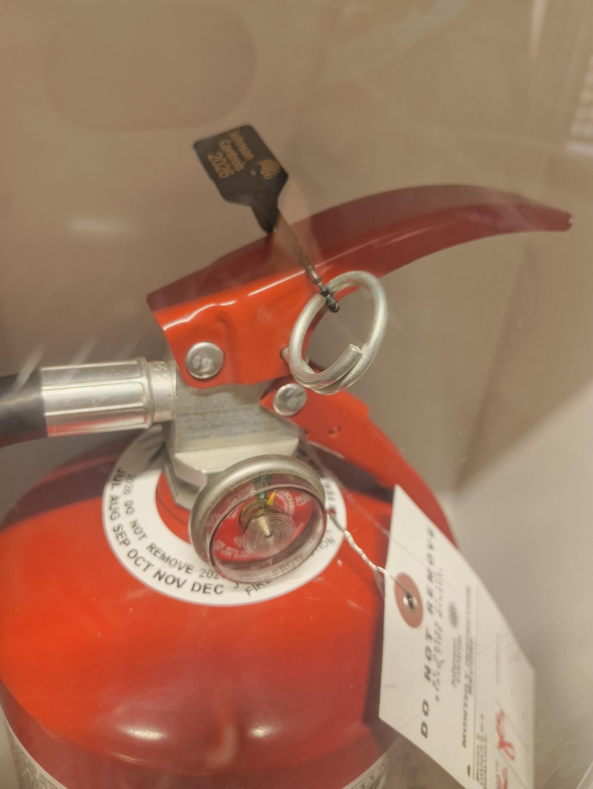

# Imaginary Affordances

## False Affordances

For a False Affordance, I chose the 'A Bit More' button on my microwave. It appears to signify a way to add a bit more time to your current microwave timer. However, the button only works to add more time if the microwave has finished its current timer, *and* you have opened and re-closed the microwave door. This is a very fancy microwave and it is always dissapointing when you try to use this button to add time mid-cook. After sketching several possible alternative interactions, the simplest was to remove the button entirely, and rely on the dial used to set the original cook time to add more time mid-cook.

## Augmented Signifier

For the Augmented Signifier, I came across this "Do Not Prop Door Open" sticker in the basement of the ATLAS building. I sketched several potential reasons this sticker might have been added, and chose hallway accessibility as the likeliest inciting incident for the agumented signage.

## Forcing Function

For the Forcing Function, I found the pin mechanism in a fire extinguisher. This is a 'Lock Sequence' constraint - the pin must be removed before fire surpressant will be dispensed. I sketched several potential reasons why this had to be implemented, and refined what I thought was the most likely (which might fall under the loaded term "Human Error").
