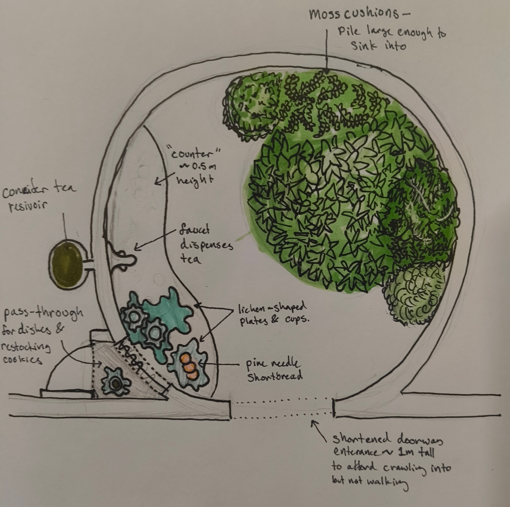
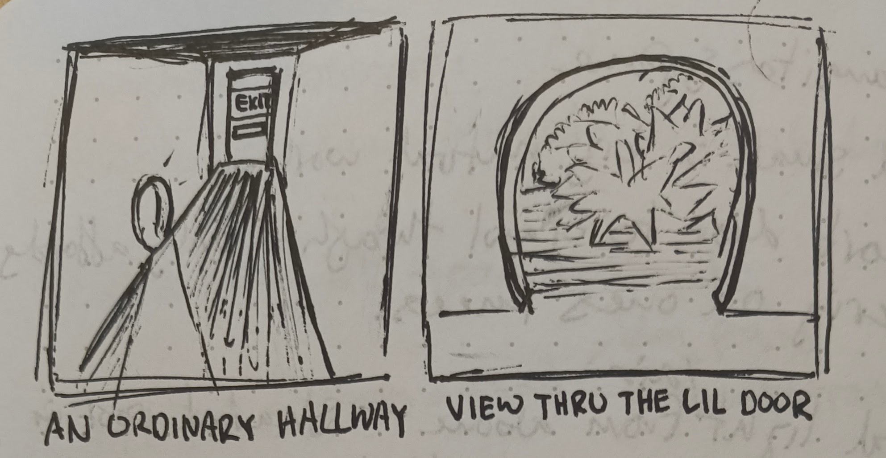
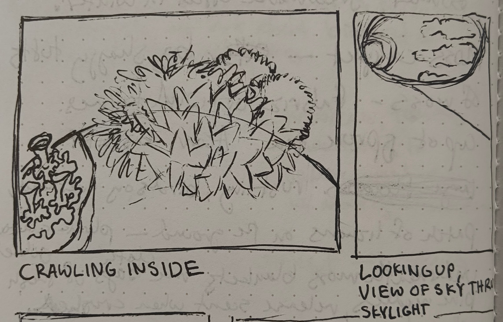
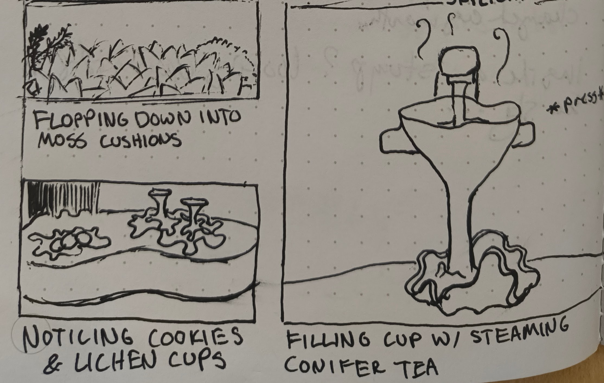

# Multisensory Space

## Inspirations

- Traditional Japanese Tea House 🍵
- The Hollow of a Mossy Tree Stump 🪾
- The feeling of being small in a big world 🌱

## Space Diagram

## Setting

The sensory space would be located in the back passageways of a DMV office. After completing some form of abysmal paperwork, The Wanderer would be directed to take a dim hallway towards the exit. About halfway down the hallway, natural light and an earthy, piney scent emenate from the entrance to the sensory room. The entrance is a rounded, shortened pass-through, one meter tall, in the side of the hallway wall. Because of the shorter door enterance, if the Wanderer wanted to investigate, they would be compelled to stoop low or kneel to see inside the room.

If they choose to crawl inside, the Wanderer would find themselves in a rounded chamber, around 2.5m in diameter, and 4m in height. The ceiling is entirely composed of a rounded, slightly-domed skylight. The walls are dark wood in a minimally refined texture, preserving natural fluctuations in thickness and shape, with some gentle sanding for smoothess. Most of the floorspace is occupied by a pile of plump, jumbo cushions covered in fabrics which emulate the colors and textures of various species of mosses, with the texture enlarged in proportion with the scale of the cushions.

If they choose to touch the mosses, the textures will be very soft. The fern frond foliage of fern mosses will be crocheted in yarn to a scale which you can run your fingers through. Star mosses will be rendered in florets of plush leaflets the size of your hands. The cushions are filled with memory foam, such that you can sink into them, and they will slowly morph back into their original shape when you relieve pressure.

The Wanderer will also notice (through aroma and sight), a plate of cookies and tray with cups, sitting on a low (0.3m), shallow (0.5m)curved counter that undulates around part of the border of the space.

The cups are in the shape of lichens, (specifically the fruting structures of *Cladonia pyxidata*, the Pebbled Pixie Cup Lichen.)

Nearby the cups, there is a spigot emerging from the wall with a wide, curved lever underneath, to signify and afford pressing a cup underneath. The spigot will dispense steaming conifer tea, which warms the cup and has a citrusy, woodsy aroma.

The cookies are a shortbread flavored with powdered pine needles. They are buttery, lightly sweetened, and the pine needles give them a bright, lemony, forest flavor.

